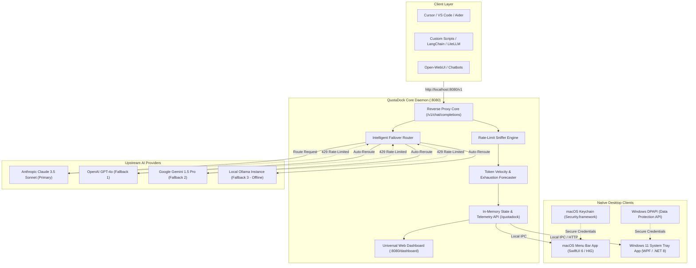

# QuotaDock ⚡
### Cross-Platform AI Quota Tracker & Zero-Downtime Failover Gateway for macOS & Windows

[](https://github.com/JaswanthRemiel/quota-dock/actions)
[](LICENSE)
[](https://github.com/JaswanthRemiel/quota-dock)
[](https://swift.org)
[](https://dotnet.microsoft.com)
[](https://golang.org)

**QuotaDock** is an open-source, FAANG-grade developer utility and microsecond local reverse proxy that permanently eliminates `429 Too Many Requests` rate-limit interruptions. By sniffing upstream response headers dynamically and tracking token velocity in real-time, QuotaDock provides instant glanceable telemetry on your desktop and executes transparent, zero-downtime failover routing across **Anthropic Claude**, **OpenAI GPT-4o**, **Google Gemini**, and local **Ollama** instances.

---

## 📑 Table of Contents
- [Why QuotaDock?](#-why-quotadock)
- [System Architecture](#-system-architecture)
- [The Technology Behind It](#-the-technology-behind-it)
  - [1. Dynamic Header Sniffing](#1-dynamic-header-sniffing)
  - [2. Token Velocity & Burn-Rate Analytics](#2-token-velocity--burn-rate-analytics)
  - [3. Zero-Downtime Transparent Failover](#3-zero-downtime-transparent-failover)
  - [4. Zero-Plaintext Hardware Security](#4-zero-plaintext-hardware-security)
- [Client Applications](#-client-applications)
  - [macOS: FAANG HIG Menu Bar App](#macos-faang-hig-menu-bar-app)
  - [Windows: Fluent Design System Tray App](#windows-fluent-design-system-tray-app)
  - [Universal: Embedded Web Dashboard](#universal-embedded-web-dashboard)
- [Installation & Quickstart](#-installation--quickstart)
  - [Prerequisites](#prerequisites)
  - [1. Running the Core Daemon](#1-running-the-core-daemon)
  - [2. Running on macOS](#2-running-on-macos)
  - [3. Running on Windows](#3-running-on-windows)
- [Workarounds & Client Configuration](#-workarounds--client-configuration)
  - [Cursor & VS Code](#cursor--vs-code)
  - [Python OpenAI SDK](#python-openai-sdk)
  - [Node.js / TypeScript SDK](#nodejs--typescript-sdk)
  - [LiteLLM / Open-WebUI](#litellm--open-webui)
- [Verification & Automated Tests](#-verification--automated-tests)
- [CI/CD Matrix](#-cicd-matrix)
- [License](#-license)

---

## 💡 Why QuotaDock?

Modern AI engineers, researchers, and developers constantly juggle multiple frontier models:
* **Anthropic Claude 3.5 Sonnet** for deep code generation and architectural reasoning.
* **OpenAI GPT-4o** for multi-step structured data and tool-calling pipelines.
* **Google Gemini 1.5 Pro/Flash** for massive context windows (up to 2M tokens).
* **Local Ollama (Llama 3.1 / DeepSeek)** for zero-cost, private offline iterations.

### The Friction:
1. **Blind Exhaustion:** Providers enforce separate rate limits on Requests Per Minute (RPM) and Tokens Per Minute (TPM). Mid-workflow, your IDE or agent crashes with an unhandled `429 Too Many Requests`.
2. **Dashboard Fatigue:** Checking your usage requires opening 4 separate browser consoles, re-authenticating, and deciphering opaque billing graphs.
3. **Broken Workflows:** When your primary provider exhausts its quota, you have to manually edit configuration files, environment variables, or IDE settings to switch providers.

**QuotaDock solves this completely.** It acts as a lightweight local proxy on `localhost:8080/v1` that silently monitors rate-limit headers on every response, estimates your exact exhaustion countdown, and automatically diverts incoming traffic to your designated fallback providers when limits are breached—with zero code changes required in your applications.

---

## 🏗 System Architecture



---

## 🔬 The Technology Behind It

### 1. Dynamic Header Sniffing
Instead of periodically polling vendor billing APIs (which burn API requests, induce rate limits themselves, and lag real-time usage by 15–30 minutes), QuotaDock snoops response headers returned from every inference call passing through the gateway:

| Provider | Requests Remaining Header | Tokens Remaining Header | Reset Time Header |
|:---|:---|:---|:---|
| **OpenAI** | `x-ratelimit-remaining-requests` | `x-ratelimit-remaining-tokens` | `x-ratelimit-reset-tokens` |
| **Anthropic** | `anthropic-ratelimit-requests-remaining` | `anthropic-ratelimit-tokens-remaining` | `anthropic-ratelimit-tokens-reset` |
| **Google Gemini** | `x-ratelimit-remaining-requests` | `x-ratelimit-remaining-tokens` | Standard epoch timestamps |

Header extraction occurs with sub-millisecond overhead in Go using zero-copy byte buffers.

### 2. Token Velocity & Burn-Rate Analytics
QuotaDock maintains a rolling exponential time-weighted average of token consumption:
$$\text{Velocity} = \frac{\Delta \text{TokensConsumed}}{\Delta t}$$

When token consumption accelerates during large prompts or agentic loops, QuotaDock calculates the **Time-To-Exhaustion (TTE)**:
$$\text{TTE} = \frac{\text{RemainingTokens}}{\text{Velocity}}$$

If TTE drops below a configurable threshold (default: 60 seconds), the status transitions from `healthy` (Green) to `warning` (Amber) and triggers preventive alerts on your desktop.

### 3. Zero-Downtime Transparent Failover
When an upstream provider returns an HTTP `429 Too Many Requests`:
1. QuotaDock intercepts the `429` status code before streaming the response to the caller.
2. The failing provider is marked `exhausted` with a cooldown timestamp mapped to its `reset` header.
3. The Failover Router automatically rewrites the payload for the next available upstream backend in the cascade:
   $$\text{Claude 3.5 Sonnet} \longrightarrow \text{GPT-4o} \longrightarrow \text{Gemini 1.5 Pro} \longrightarrow \text{Ollama Local}$$
4. The client receives an HTTP 200 stream with zero downtime or manual intervention.
5. Once the reset duration elapses, the primary provider is seamlessly re-promoted.

### 4. Zero-Plaintext Hardware Security
* **macOS:** API keys are never written to disk or plain environment files; they are encrypted via Apple's native **macOS Keychain** using the `Security.framework` API with `kSecClassGenericPassword`.
* **Windows:** API keys are encrypted at rest using **Windows Data Protection API (DPAPI)** via `System.Security.Cryptography.ProtectedData` (`DataProtectionScope.CurrentUser`), binding decryption to your logged-in Windows security principal.

---

## 🖥 Client Applications

### macOS: FAANG HIG Menu Bar App
* Implemented in **Swift 6** using SwiftUI's `MenuBarExtra`.
* Designed strictly against Apple Human Interface Guidelines (HIG):
  * Dynamic vibrancy materials (`.ultraThinMaterial`).
  * San Francisco typography with tabular monospaced digits (`.monospacedDigit()`) to prevent frame jitter.
  * Adaptive traffic-light status rings (Emerald Green $\ge 30\%$, Amber $< 30\%$, Crimson $\le 5\%$).
* Compact 340pt fixed popover with smooth spring animations.

### Windows: Fluent Design System Tray App
* Implemented in **C# / .NET 8 (WPF)** with Windows 11 Fluent Design.
* Single-instance system tray icon with Windows notification area integration.
* Acrylic drop-shadow flyout anchored above the taskbar.
* Dark/Light mode synchronization with Windows system theme.

### Universal: Embedded Web Dashboard
* Zero-dependency dashboard embedded directly in the Go daemon binary at `http://localhost:8080/dashboard`.
* Live SVG telemetry dials, token burn rate meters, and active failover logs.
* Fully functional across Chrome, Edge, Safari, and Firefox.

---

## 🚀 Installation & Quickstart

### Prerequisites
* **For Daemon:** [Go 1.22+](https://go.dev/dl/)
* **For macOS App:** macOS 13.0 (Ventura) or newer with Xcode 15+
* **For Windows App:** Windows 10/11 with [.NET 8.0 Runtime](https://dotnet.microsoft.com/download/dotnet/8.0)

---

### 1. Running the Core Daemon

Clone the repository and build the daemon:

```bash
git clone https://github.com/JaswanthRemiel/quota-dock.git
cd quota-dock/daemon

# Run the daemon directly
go run . -port 8080

# Or build a standalone binary
go build -o quotadock-daemon .
```

The daemon starts on `http://127.0.0.1:8080`.

---

### 2. Running on macOS

```bash
cd quota-dock/macOS

# Build and run with Swift Package Manager
swift run QuotaDock
```
QuotaDock will appear in your macOS menu bar with real-time status rings.

---

### 3. Running on Windows

**Option A: Using the PowerShell launcher**
```powershell
.\scripts\run-windows.ps1
```

**Option B: Building the native .NET 8 System Tray App**
```powershell
cd windows\QuotaDock.Windows
dotnet build -c Release
dotnet run
```

**Option C: Zero-compilation Python companion**
```powershell
python windows\tray_app.py --dashboard
```

---

## 🛠 Workarounds & Client Configuration

QuotaDock is drop-in compatible with any tool or SDK that supports changing the OpenAI base URL.

### Cursor & VS Code
1. Open Cursor / VS Code Settings (`Ctrl+,` or `Cmd+,`).
2. Search for **OpenAI Base URL**.
3. Set the endpoint to:
   ```text
   http://localhost:8080/v1
   ```
4. Enter any dummy key or your provider key in the API key field. All requests will now be tracked and protected by QuotaDock!

---

### Python OpenAI SDK

```python
from openai import OpenAI

# Direct client to QuotaDock local gateway
client = OpenAI(
    base_url="http://localhost:8080/v1",
    api_key="your-api-key" # or leave blank if managed via QuotaDock Keychain/DPAPI
)

response = client.chat.completions.create(
    model="claude-3-5-sonnet-20241022", # will fail over to gpt-4o automatically if 429 occurs
    messages=[{"role": "user", "content": "Explain quantum computing in 2 sentences."}]
)

print(response.choices[0].message.content)
```

---

### Node.js / TypeScript SDK

```typescript
import OpenAI from "openai";

const openai = new OpenAI({
  baseURL: "http://localhost:8080/v1",
  apiKey: process.env.OPENAI_API_KEY || "dummy",
});

async function main() {
  const completion = await openai.chat.completions.create({
    model: "claude-3-5-sonnet-20241022",
    messages: [{ role: "user", content: "Hello QuotaDock!" }],
  });
  console.log(completion.choices[0].message.content);
}

main();
```

---

### LiteLLM / Open-WebUI
In your `litellm_config.yaml` or Open-WebUI environment:
```yaml
model_list:
  - model_name: quotadock-gateway
    litellm_params:
      model: openai/custom
      api_base: http://localhost:8080/v1
      api_key: dummy
```

---

## 🧪 Verification & Automated Tests

To run the automated rate-limit simulation and header sniffing test suite:

```bash
cd daemon
go test -v ./...
```

To run the mock upstream server simulating synthetic 429 rate limits:

```bash
python scripts/test_mock_server.py
```

---

## 🔄 CI/CD Matrix

Every commit and pull request is automatically validated via GitHub Actions (`.github/workflows/ci.yml`) across:
* **Ubuntu Latest:** Go 1.22 daemon compilation and race-detection unit tests.
* **macOS 14 (Sonoma):** Swift 6 build and SwiftUI unit tests.
* **Windows Latest:** .NET 8 WPF system tray build and Go Windows x64 binary compilation.

---

## 📄 License

Distributed under the **MIT License**. See [`LICENSE`](LICENSE) for details.

Developed with ⚡ by **[Jaswanth Remiel](https://github.com/JaswanthRemiel)** and the autonomous AI team.
